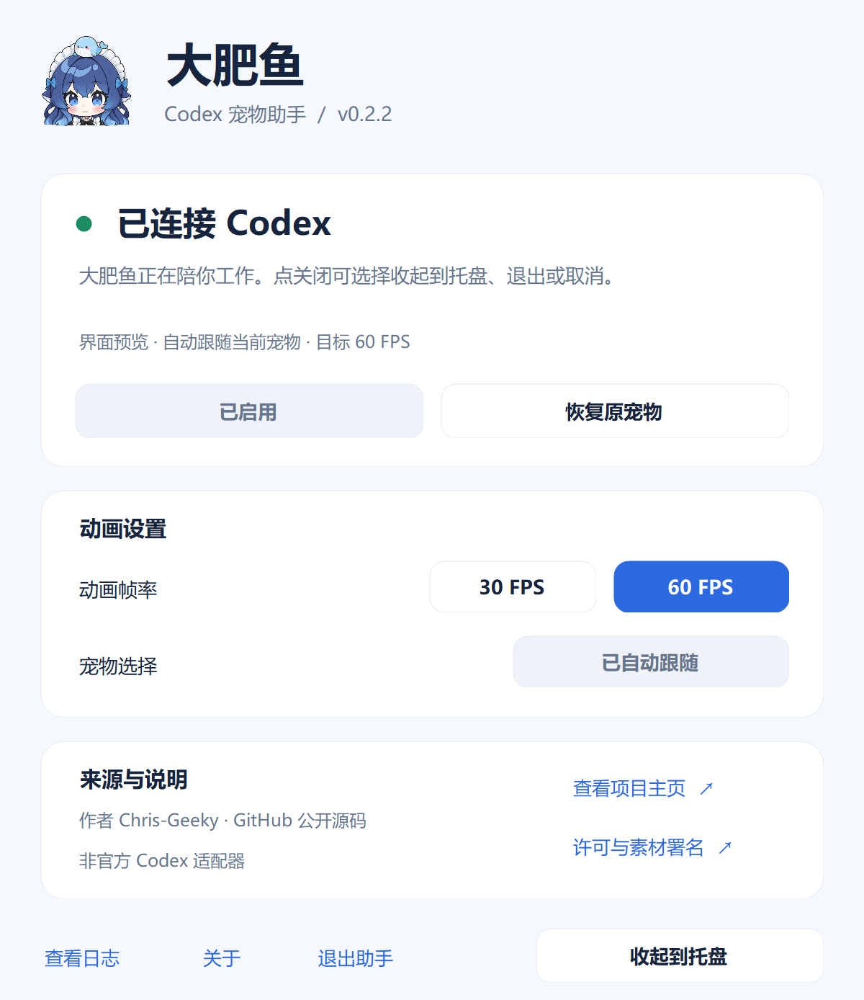

# Codex 大肥鱼 Live2D

在**官方 Codex 的原生宠物窗口**中显示 DS 鲸鱼娘：连续绘制、自然眨眼、视线变化和任务状态动作。适用于 Windows x64。它是非官方适配器，需要配合已安装的 Codex 使用。

**[下载 Windows x64 便携预览版](https://github.com/Chris-Geeky/codex-dafeiyu-live2d/releases)** · [使用与许可说明](NOTICE.md)

模型为桌前半身鲸鱼娘，包含待机、敲桌、吹泡泡、喷水、拿手机、自拍、快速自拍和番茄酱动作。待机动作轮换，动作间休息约 4.5–8.5 秒。目标帧率 60 FPS，可切换为 30 FPS。

## 控制面板

控制面板可以直接查看连接状态、切换帧率、恢复原宠物及查看日志。v0.2.2 点击窗口右上角关闭按钮时，会先询问“收起到托盘 / 退出助手 / 取消”：默认选中收起，Enter 收起后继续后台运行，Esc 取消关闭。选择退出才恢复原宠物并退出助手，Codex 继续运行。面板和托盘中的明确“退出助手”命令仍直接退出。双击程序或托盘图标可重新打开控制面板。



界面预览使用演示状态；当前连接结果以你自己电脑上的控制面板为准。状态刷新直接读取本机状态文件，不再定时启动 Node 进程。

所有尺寸保留同一张鲸鱼娘原图的五官、耳朵和头饰；16–64 像素小图标采用实际像素对照中选定的 B 档轻锐化，大头像保持原样。已确认的常用尺寸保存为固定 PNG 像素帧，打包时直接装入 ICO，避免重复采样。窗口与托盘按当前 DPI 选取对应帧。

## 便携版使用

1. 安装并登录官方 Codex，在 Codex 中选择一个宠物、显示宠物窗口。内置宠物或你自己已有的宠物均可。
2. 完整解压 Windows x64 便携包，双击 **`CodexDafeiyu.exe`**。不要只复制 exe，也不要在压缩包内直接运行。便携包自带 Node.js，无须额外安装。
3. 首次使用会显示动画组件说明。点击链接阅读 Live2D Core 许可，勾选同意并确认后，启动器从 Live2D 官方下载约 203 KB 的运行库并校验固定 SHA-256。此组件不在 GitHub 源码或便携包中；程序不会自动弹出浏览器。
4. 如果 Codex 已经通过普通图标运行，请完成当前工作，再**从系统托盘完整退出 Codex**。只关闭窗口可能仍在后台运行。启动器会等候正常退出后，用原来的账号和数据重新打开，不会强制关闭聊天。
5. 默认自动跟随这台电脑当前显示的宠物；Live2D 成功绘制后才隐藏原图。启动时短暂显示默认宠物、随后恢复自定义宠物时，也会继续跟随。

以后从 `CodexDafeiyu.exe` 启动。右键系统托盘图标，可以打开面板、启用、恢复原宠物、恢复自动跟随、切换 30/60 FPS 或查看日志。再次双击 exe 会显示已在运行的控制面板。启动器是后台连接程序，角色仍在 Codex 的宠物窗口中。

更换电脑或 GitHub 账号不需要复制任何原作者的私人数据。接收者使用自己的 Codex 登录和宠物；自动模式下切换账号或宠物后，无需重新绑定。

**从 v0.1.0 升级：** 旧版可能将启动时临时显示的默认宠物保存为固定绑定。退出旧托盘助手、启动新版后，在托盘选择一次“自动跟随当前宠物”以清除旧绑定。通过命令行手动设置的固定 ID 仍受支持。

> 已验证官方 Codex Windows 商店包 `26.1023.6621.0`；`26.1027.3384.0` 已在日常账号的原生宠物窗口确认模型加载及连续绘制。其他客户端版本可能更改内部页面接口，需要重新验证；目前不支持 macOS、Linux 或 Windows ARM64。便携启动器尚未代码签名。

## 恢复和卸载

面板选择“恢复原宠物”，或退出助手。恢复不会关闭 Codex，不会更改云端宠物记录。

需要关闭调试端口时，完整退出 Codex，再从原来的官方 Codex 图标打开。卸载本工具只需退出启动器、删除解压目录；本机数据在 `%LOCALAPPDATA%\CodexDafeiyuLive2D`，需要时可另行删除。工具没有注册开机启动，也不会修改 Codex 安装文件或原快捷方式。

## 从源码运行

安装 Node.js 22 或更新版本。源码已经包含模型和固定哈希的渲染 vendor，无运行时 npm 依赖。

先阅读 [Live2D 专有软件许可](https://www.live2d.com/eula/live2d-proprietary-software-license-agreement_en.html)，同意后运行：

```powershell
node setup.mjs --accept-live2d-license
node cli.mjs verify
node launch.mjs start --wait-for-exit --open-pet
```

也可在准备好 Core 后双击 `Start-Live2D.cmd`，在后台等候启动。恢复用 `Restore-Pet.cmd`。

```powershell
node launch.mjs status
node launch.mjs environment
node launch.mjs restore
# 修改绑定和帧率前，先执行 restore 并等候控制器退出
node launch.mjs configure --pet-id auto --fps 30
```

显式固定某个宠物可用 `configure --pet-id YOUR_PET_ID`，`--pet-id auto` 恢复自动跟随。自动模式中的 `petId` 保持 `null`，不将启动时临时出现的默认宠物保存为绑定。本机设置不提交到仓库。测试或并存部署可设置 `DAFEIYU_DATA_DIR`，将本工具的数据放到独立目录；不要把它指向 Codex 的账号数据目录。

## 构建便携包

在 Windows x64 上运行，需 Windows 自带的 .NET Framework C# 编译器、PowerShell 和 curl：

```powershell
powershell.exe -NoProfile -ExecutionPolicy Bypass -File scripts/Build-Portable.ps1
```

构建脚本从 Node.js 官方取得 `24.21.0` 的 Windows x64 压缩包，与同一官方版本的 `SHASUMS256.txt` 比对，保留完整 Node 许可，再编译 C# 托盘启动器。只按明确文件清单组装 `dist/`，排除 Core 缓存、会话、账号、日志和测试资料。生成 zip 和 SHA-256 校验文件。输出已存在时不会删除或覆盖，可通过 `-OutputDirectory` 指定新的输出目录。

原生窗口面向 .NET Framework 4.8，使用普通用户权限运行；嵌入作者／版本元数据、15 个分辨率的 ICO 和高 DPI 配置。`scripts/Build-Launcher.ps1` 可单独编译界面，`scripts/Test-Launcher.ps1` 检查许可确认、关闭选择和控件状态。`assets/branding/app-avatar.png` 是鲸鱼娘头像源图，`native-*.png` 是已确认的小尺寸渲染结果，`npm run build:branding` 可通过本机 Edge 重建 PNG／ICO 并更新哈希；预生成图标已随源码提供，普通构建不需要浏览器。`CodexDafeiyu.exe --quit` 可供更新程序请求助手正常退出，仍会恢复原宠物。

重建渲染 vendor：

```powershell
cd build
npm ci --ignore-scripts --no-audit --no-fund
cd ..
node scripts/build-vendor.mjs
node cli.mjs verify
```

依赖锁定为 PixiJS `8.19.0`、untitled-pixi-live2d-engine `1.3.5`、esbuild `0.25.10`。使用 Pixi 官方 `pixi.js/unsafe-eval` 兼容模块避免动态代码生成，不修改宿主 CSP。生成文件哈希同步更新到 `assets-manifest.json`。

## 实现和已知边界

- 通过 `127.0.0.1` 的 CDP 调试端口接入官方 `/avatar-overlay` 页面；不修改 `app.asar`、可执行文件或签名。它不是官方 Live2D API，客户端更新可能使适配失效。
- 调试端口没有认证，本机其他同权限进程可以访问。关闭端口需完整退出该次 Codex 进程。
- 完整退出 Codex 后，控制器自动停止。普通启动的 Codex 没有调试端口时无法热接入，需要统一启动入口或一次正常退出；托盘监听不能绕过这一点。
- 仅读取宠物 DOM 属性、发送打开宠物的 UI 消息，不读取聊天正文、密码或账号令牌，也不上传模型。运行时联网仅首次准备官方 Core；Codex 自身的联网行为不由本工具控制。
- 资源经过 SHA-256 校验，以内存 Blob 加载。Core 文件和渲染器初始化失败时，不隐藏原图。内部页面部分变化时仍可能出现交互兼容问题，可用托盘恢复或完整退出后普通启动。
- 所有动作保持相同角色比例；角色比最初的原型放大约 6%，增加画布留白容纳锤子动作。按可见轮廓生成命中条带，并过滤原生按钮的接近展开信号，避免透明边缘唤出按钮。
- 页面隐藏或系统设置减少动态效果时暂停连续绘制。模型为半身绑定，没有全身走路、舞蹈动作。目标帧率不等于所有设备上的实测帧率。

## 验证

```powershell
npm test
npm run verify
# 先准备 Core；默认查找 Windows 上的 Edge，可用 EDGE_BINARY 指定 Chromium
npm run test:browser
```

单元测试覆盖本机数据隔离、默认不绑定作者账号、配置校验、资源完整性、Core 许可门槛和官方宠物页面筛选。浏览器集成测试使用独立的无头浏览器配置和真实模型，检查严格 CSP、命中区域、按钮展开、事件透传及恢复，不连接你的日常 Codex。

v0.2.2 通过 9 项单元检查、29 项原生界面和图标检查，渲染与自动跟随沿用已通过 23 项浏览器集成检查的实现。验证包括默认宠物切换到自定义宠物、自动模式不写入固定绑定、许可明确同意、界面忙碌时避免冲突操作、关闭默认收起和 Esc 取消；另检查六种界面状态和高 DPI 排版。便携包通过编译、67 个资源完整性检查及图标／作者元数据／exe 文件自检。

此前在官方原生宠物窗口已验证连续动画、状态同步、窗口重建、尺寸保持、四周空白不展开按钮，以及恢复。原生窗口短时观测约 58.7 FPS；新便携启动器的文件自检与浏览器测试不能替代在每台接收者电脑上的完整验证。真实云端任务和语音交互未做完整测试。

## 署名与许可

角色原作 **上善无形**（原创 OC「溟月」），DeepSeek 女仆鲸鱼娘二次设计 **ZipZipPipe**，Live2D 模型、绑定与动作 **氵六青**。来自 [A8Chann/dsh-pet-live2d](https://github.com/A8Chann/dsh-pet-live2d/tree/053f0837284c4997634842e77906c083b060f9d1)。

适配器代码：MIT。模型及美术：**CC BY-NC-SA 4.0，署名、非商业、相同方式共享**。Live2D 组件另有条款；下载 Core 不会免除使用或发行义务。详见 [NOTICE.md](NOTICE.md)、[模型许可](assets/model/LICENSE) 和 [第三方来源](third-party/SOURCES.md)。

本项目不是 OpenAI、DeepSeek 或 Live2D 官方产品。

程序当前未进行发布者数字签名。“关于”会显示实际签名状态；程序图标和作者元数据不代替数字签名。Windows 的发布者与信誉提示仍可能出现，签名也不保证新程序立即获得信誉，参见 [Microsoft 的 SmartScreen 说明](https://learn.microsoft.com/en-us/windows/apps/package-and-deploy/smartscreen-reputation)。
